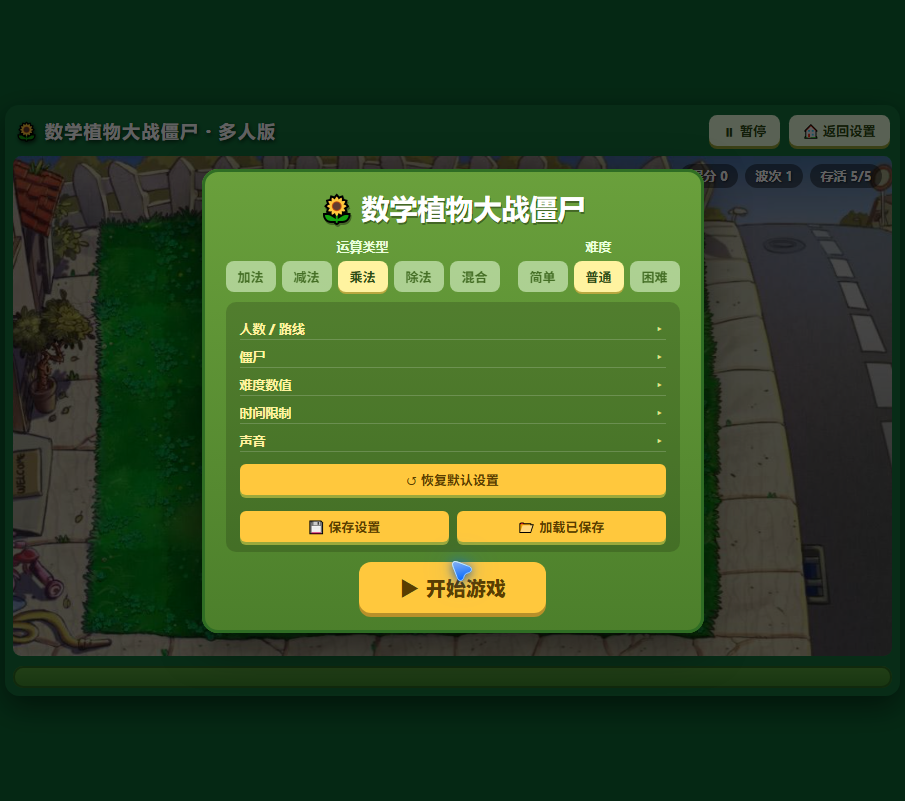
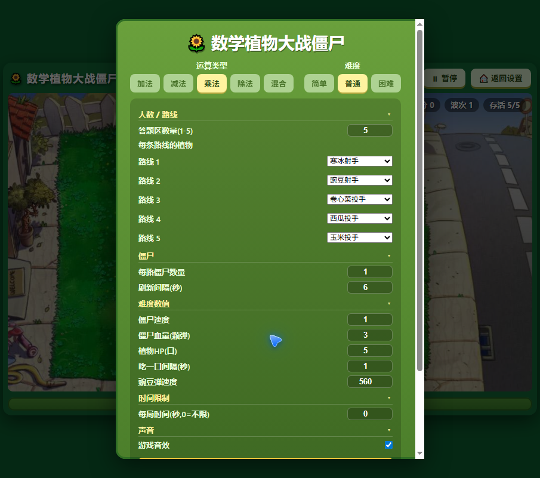
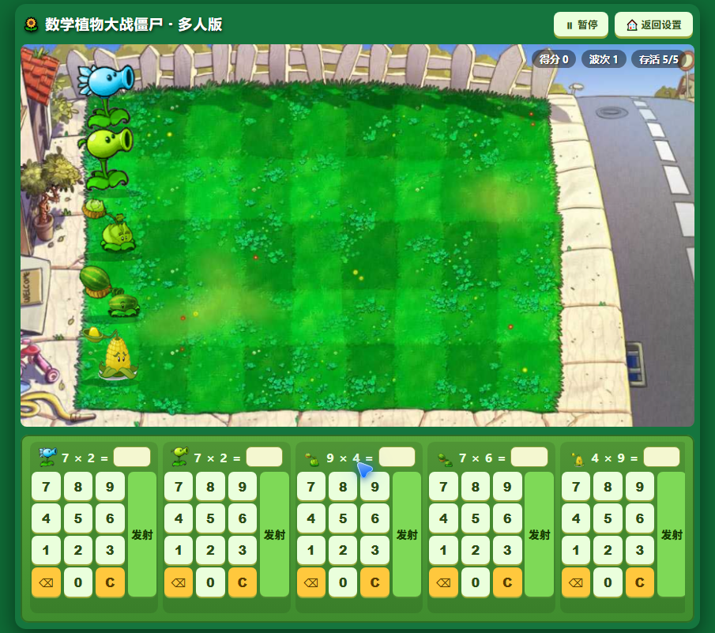
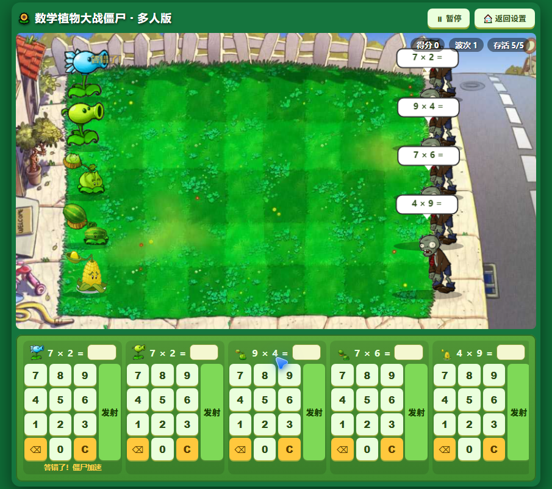

# 数学植物大战僵尸 · Math Plants vs Zombies

一个把小学数学运算和经典《植物大战僵尸》玩法结合的**单文件网页游戏**：答对算式 → 植物开火 → 僵尸推进 → 啃食 → 结算。支持 **1～5 人**各占一路（默认 5 路），使用**原版 PvZ 贴图与真帧动画**。

> 单文件 HTML，零依赖，双击即可运行。所有图片、音效均已内嵌（base64），无需联网。

---

## 📸 截图

**设置界面**（运算类型 / 难度 / 人数路线 / 僵尸 / 难度数值 / 时间限制 / 声音）



**完整设置面板**（含"恢复默认 / 保存设置 / 加载已保存"）



**游戏进行中**（5 路植物 + 僵尸 + 答题键盘）



**发射与答题反馈**（答对开火 / 答错僵尸加速）



---

## ✨ 功能特性

- **数学玩法**：加法 / 减法 / 乘法 / 除法 / 混合五种运算类型，简单 / 普通 / 困难三档难度。
- **多人对战**：1～5 人各占一路，每路独立答题、独立植物、独立僵尸与通关判定。
- **五种植物**：寒冰射手（减速）、豌豆射手、卷心菜投手、西瓜投手、玉米投手——全部使用原版 PvZ 贴图与**整套待机 / 发射 / 投掷动画**。
- **完整设置面板**：人数与路线、每路植物、僵尸数量 / 刷新间隔 / 速度 / 血量、植物 HP、啃食间隔、弹速、每局时间限制、音效开关。
- **保存设置**：将整套配置一键存档（localStorage），下次打开点"加载已保存"即恢复，无需重设。
- **原版音效 + BGM**：读秒结束后背景音乐缓入。
- **答对开火，答错惩罚**：答对植物发射子弹 / 投掷物，答错当前路僵尸加速。
- **结算统计**：胜利 / 失败面板展示每位玩家的得分（击杀数）与通过时间。
- **窗口自适应**：任意窗口尺寸下游戏界面完整缩放、无滚动条。

---

## 🎮 玩法说明

1. 打开页面 → 在**设置面板**配置好参数（或点"加载已保存"直接恢复上次配置）。
2. 点击「**开始游戏**」，倒计时读秒后开战。
3. 每位玩家对应一路，根据僵尸上方的算式输入答案，点击「**发射**」。
4. **答对** → 植物开火攻击该路僵尸；**答错** → 该路僵尸加速前进。
5. 僵尸到达植物后会啃食，植物有血量（可配置）。
6. 消灭一路的全部僵尸 → 该路通关；所有路通关 → **获胜**；植物被吃光 / 时间到 → **失败**。

---

## 🚀 如何运行

### 方式一：直接双击
双击 `index.html`，浏览器打开即玩。

### 方式二：本地服务器（可选）
```bash
# 任选其一
python -m http.server 8080
npx serve
```
浏览器访问 `http://localhost:8080`。

### 方式三：GitHub Pages
将本仓库托管到 GitHub，在仓库 `Settings → Pages` 启用后即可在线游玩。

> 提示：修改游戏后若浏览器仍显示旧版本，请在 URL 后加 `?v=<时间戳>` 强制刷新缓存。

---

## 🛠 技术栈

- **纯前端单文件**：HTML + CSS + JavaScript + Canvas 2D
- 无任何框架 / 依赖 / 构建工具，所有资源（贴图、音效、BGM）内嵌 base64
- 存档使用 `localStorage`

---

## 📁 目录结构

```
math-plants-vs-zombies/
├── index.html          # 游戏本体（单文件，含全部资源）
├── README.md
├── LICENSE
└── screenshots/        # 展示与功能截图
    ├── 01-menu.png
    ├── 02-settings.png
    ├── 03-gameplay.png
    └── 04-fire-effect.png
```

---

## 📄 开源协议

本项目代码采用**自定义非商用许可（Non-Commercial Software License 1.0）**（见 [LICENSE](LICENSE)）：允许免费查看、学习、修改与非商业分享，但**禁止任何商业用途**（不得售卖、提供收费服务或用于盈利项目）。

> ⚠️ 注意：游戏中使用的植物 / 僵尸贴图与音效素材取自经典游戏《植物大战僵尸》，其版权归原版权方（PopCap / EA）所有，仅用于**学习交流与个人娱乐**，请勿用于任何商业用途。
